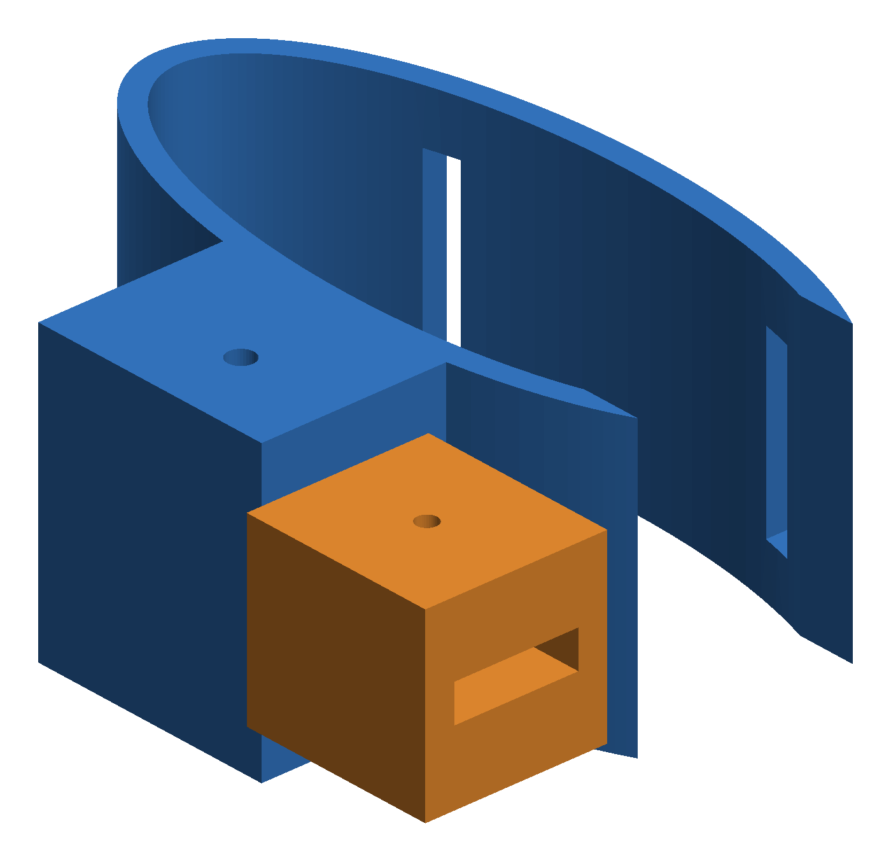
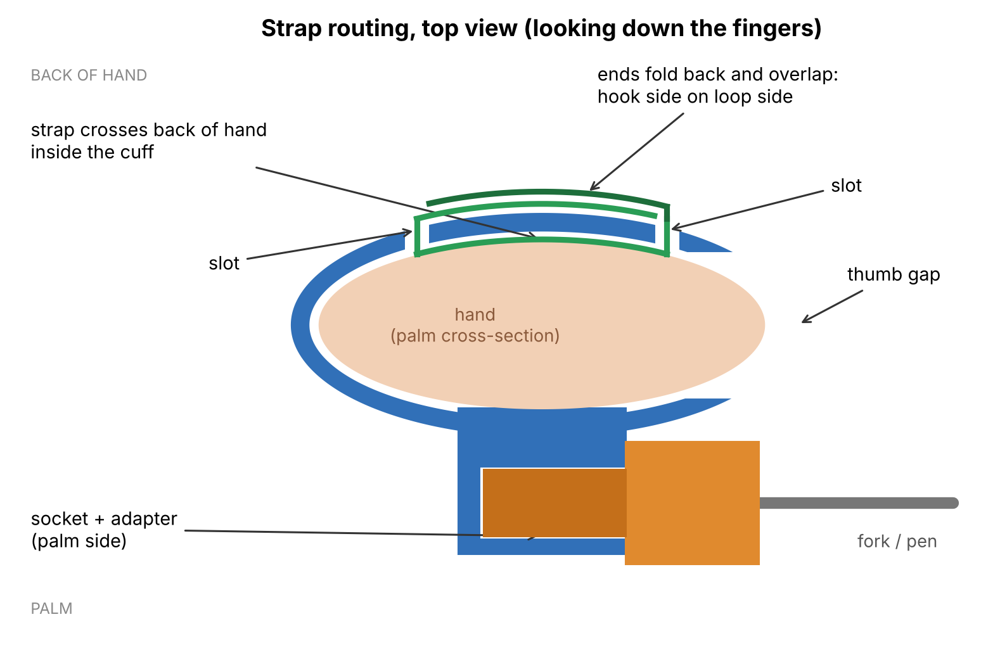
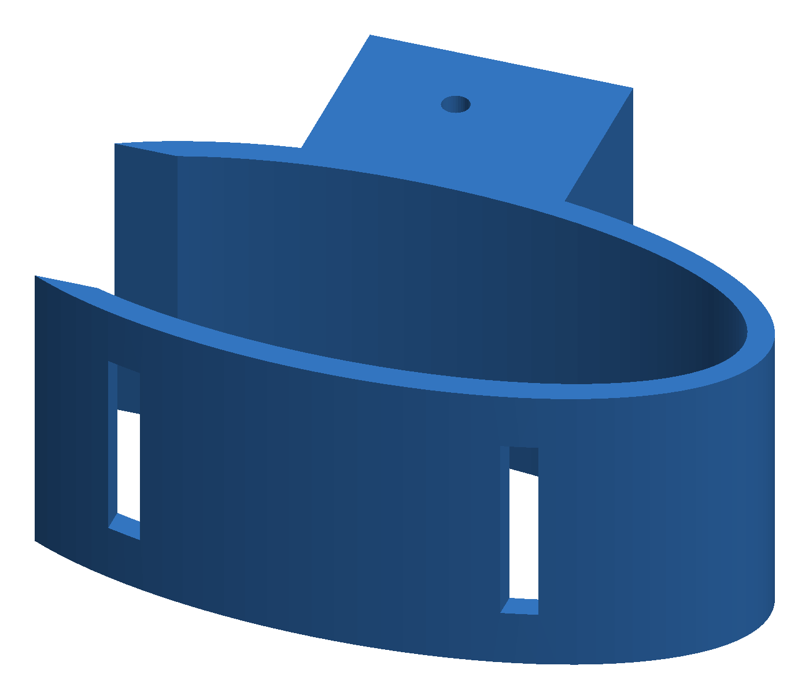
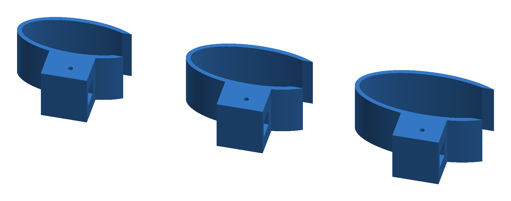

# Universal Grip Cuff

A 3D-printable hand cuff that holds a fork, a toothbrush or a pen for people who can't close their grip. One cuff, swappable tool adapters, a hook-and-loop strap, three sizes, about $1.60 of filament.



## The problem

Brushing your teeth needs grip. So does eating, writing and holding a phone. After a stroke, a spinal cord injury, or with arthritis or cerebral palsy, that grip can disappear while the daily tasks stay.

Assistive products close that gap, but nearly a billion people who need them go without. WHO estimates 2.5 billion people need one or more assistive products, and in some settings access is as low as 3% ([WHO](https://www.who.int/health-topics/assistive-technology/improving-access-to-assistive-technology)). The WHO and UNICEF Global Report on Assistive Technology found nearly one billion people are denied access, that around two thirds of users paid out of pocket, and that service gaps are largest in cognition, communication and self-care ([WHO/UNICEF report summary](https://www.infodocket.com/2022/05/16/new-from-who-and-unicef-almost-one-billion-children-and-adults-with-disabilities-and-older-persons-in-need-of-assistive-technology-denied-access-according-to-new-report/)).

In June 2026 WHO and UNICEF brought 89 participants from 14 African countries to Nairobi to work on faster access to assistive technology, with supply and provision systems among the priorities ([WHO, 2026](https://www.who.int/publications/m/item/WHO-HSD-HPS-PAM-2026.2)).

Self-care is where a simple device does a lot. A universal cuff is one of the most basic tools in occupational therapy. A commercial elastic ADL cuff for utensils lists at $25.80 ([AliMed](https://www.alimed.com/products/universal-elastic-adl-cuff)). That is cheap in a US clinic. It is not cheap everywhere, and most fabric cuffs only take flat handles.

## The solution

A rigid cuff slides over the hand. A square socket sits on the palm side. Tool adapters plug into that socket and lock with one M3 bolt. Each adapter clamps a tool with a set screw.

Swap a fork for a pen in seconds. Print a new adapter when you need a new tool. The cuff stays the same.

A rigid cuff alone would slide off or spin. So the back of the band has two slots for a 20 mm hook-and-loop (Velcro) strap. The strap goes in one slot, crosses the back of the hand inside the cuff, and comes out the other. Pull both ends and the strap presses the hand down onto the palm side of the cuff. Fold the ends back over the outside and stick hook onto loop. The cuff is now locked to the hand.






Everything is built by a parametric Fusion 360 script. Change palm width, palm depth or socket size, run it again, and you get a new fit. No manual CAD work.

## How it's used

1. **Load a tool.** Push the handle into an adapter and tighten the set screw. Fork in the flat adapter, pen in the round one.
2. **Attach the adapter.** Slide it into the socket from the thumb side and push the M3 bolt through.
3. **Put it on.** Thread the strap through both slots first. Slide the cuff over the fingers like a wide bracelet until it sits at the knuckles. The thumb goes out the side gap.
4. **Lock it.** Pull the strap ends snug and fold them over each other on the back of the cuff. A caregiver can do this in one motion, and so can many users with their other hand.
5. **Use it.** The tool sticks out past the thumb, across the palm. The fingers don't grip anything. The arm and wrist steer the tool.

## Similar designs

This idea is not new, and it shouldn't be. Universal cuffs have been around for decades. Here is the work closest to this one.

- **Volksswitch Customizable Universal Cuff Utensil/Tool Holder** ([Volksswitch](https://volksswitch.org/index.php/volks-devices/personalized-cuff-utensil-holder/)). Open source and parametric. It splits the device into a palm loop and a separate utensil mount joined by a dovetail interface, so each part sizes on its own. Same core idea as this project.
- **US4602885A, Implement holding cuff (1986)** ([Google Patents](https://patents.google.com/patent/US4602885A/en)). Adjustable cuff that holds an elongated implement for people with little or no hand function.
- **US5597189A, Prosthetic utensil and tool holding device (1997)** ([Google Patents](https://patents.google.com/patent/US5597189)). Rigid adjustable band with interchangeable tools, built for either hand.
- **US12233527B2, Adaptive utensil holder (2025)** ([Google Patents](https://patents.google.com/patent/US12233527B2/en)). An add-on holder that plugs into a standard universal cuff and sets the utensil at an angle.

What this version does differently:
- Rigid C-shaped cuff locked by a hook-and-loop strap routed through two slots, so it can't slide or spin.
- Square 12 mm socket with an M3 cross pin, so adapters lock in place instead of relying on friction.
- Set-screw adapters that clamp both flat and round handles.
- Prints with no supports.

None of this is proven better yet. That is what printing and OT testing are for.

## Key characteristics

- **Modular.** One cuff, many tools. The socket is a standard 12 mm square interface.
- **Two adapters included.** Flat slot (4.5 x 15 mm) for forks, spoons and toothbrushes. Round bore (11 mm) for pens, pencils and markers.
- **Three sizes.** S, M and L cuffs, all sharing the same adapters.
- **Strap lock.** Two slots on the back of the band take a 20 mm hook-and-loop strap. It takes up the skin clearance and stops the cuff from sliding or spinning.
- **Open thumb side.** The cuff is a C shape, so the thumb stays free.
- **No supports.** The cuff prints standing on its band edge. The socket boss runs the full band height, so nothing overhangs.
- **Cheap hardware.** One M3 bolt as a cross pin, one M3 self-tapping screw as a set screw.
- **Parametric.** Every dimension lives at the top of the script.
- **Checked for fit.** A mesh boolean test confirms each adapter seats in each cuff with zero overlap (see [testing](testing/README.md)).

## Specs

All dimensions measured from the exported STL files.

| Part | Bounding box (mm) | Solid volume (cm³) | Mass at 100% PETG (g) |
|---|---|---|---|
| Cuff S | 71.7 x 57.2 x 35.0 | 33.06 | 42.0 |
| Cuff M | 79.2 x 61.2 x 35.0 | 34.63 | 44.0 |
| Cuff L | 86.6 x 65.2 x 35.0 | 36.17 | 45.9 |
| Adapter Flat | 49.5 x 22.0 x 22.0 | 13.62 | 17.3 |
| Adapter Round | 49.5 x 22.0 x 22.0 | 13.05 | 16.6 |



Fit parameters by size:

| Size | Palm width | Palm depth | Thumb gap | Strap slot spacing |
|---|---|---|---|---|
| S | 70 | 26 | 22 | 40 |
| M | 80 | 30 | 26 | 45 |
| L | 90 | 34 | 30 | 50 |

Shared: 2 mm skin clearance, 3 mm wall, 35 mm band height, 12.4 mm socket for a 12 mm shank (0.2 mm per side), 26 mm socket depth, 3.2 mm cross pin hole, 4 x 22 mm strap slots for a 20 mm strap.

## Impact

Who it helps: people with weak or no grip who can still move the arm. That includes stroke survivors, people with spinal cord injuries, arthritis, or cerebral palsy, and older adults losing hand strength. The target task is self-care: eating, brushing, writing.

Cost: a full kit (one cuff plus both adapters) is 76 to 80 g of PETG even at 100% infill. At $20 per kg of filament that is $1.52 to $1.60, plus one M3 bolt, one M3 screw and about 20 cm of 20 mm hook-and-loop strap. Compare that with $25.80 for a single commercial fabric cuff that only takes flat handles. These are material estimates, not a full cost with labor and printer time.

Local production: a clinic or school with one desktop printer can make every size. When a hand changes size, print a new cuff and keep the adapters.

## Repo layout

```
cad/fusion/   Fusion 360 archives (.f3d), one per size
cad/step/     STEP files, one per size
stl/size-S/   Cuff S
stl/size-M/   Cuff M
stl/size-L/   Cuff L
stl/adapters/ Flat and round tool adapters
scripts/      Fusion 360 Python script + fit check
renders/      Images
docs/         Design notes, sizing, BOM
testing/      Fit check method and print test plan
```

## How to print

1. Measure palm width across the knuckles and palm thickness. Pick the closest size.
2. Print one cuff and the adapters you need. PETG is recommended. PLA works for a first fit test.
3. Settings: 0.2 mm layers, 4 walls, 30 to 40% infill. Print the cuff standing on its band edge so layers wrap around the hand. Print adapters with the shank pointing up.
4. Push an adapter into the socket from the thumb side. Line up the holes and insert an M3 x 40 bolt.
5. Slide the tool into the adapter. Tighten the M3 set screw.
6. Cut about 20 cm of 20 mm hook-and-loop strap, or use a one-wrap strap. Thread it through both slots from the outside so it crosses the inside of the band.
7. Sand or deburr any edge that touches skin. A thin foam liner fits inside the 2 mm clearance.

Custom size: open `scripts/universal_grip_cuff/universal_grip_cuff.py`, edit `SIZES` or `P`, and run it in Fusion (Utilities > Add-Ins > Scripts and Add-Ins > + > script from device).

## Status and next steps

Status: CAD complete in three sizes with strap slots. Digital fit check passed. Not yet printed or tested on a hand.

Next:
- Print test in PETG, check socket fit and pin alignment
- Test strap hold: does the cuff stay put while eating and writing?
- Round all skin-contact edges with fillets
- Add a ball-joint adapter for angle adjustment
- Add adapters for a phone stylus and a toothbrush with a thick handle
- Get feedback from an occupational therapist

## Author

Carlos Ortega, Biomedical Engineering, Florida State University

## Disclaimer

Not a certified medical device. For research and educational use only. Anyone using it on a person should do so with guidance from a qualified clinician.
